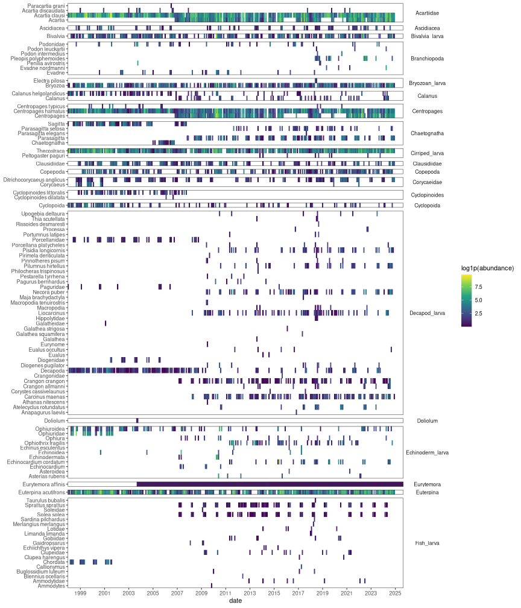
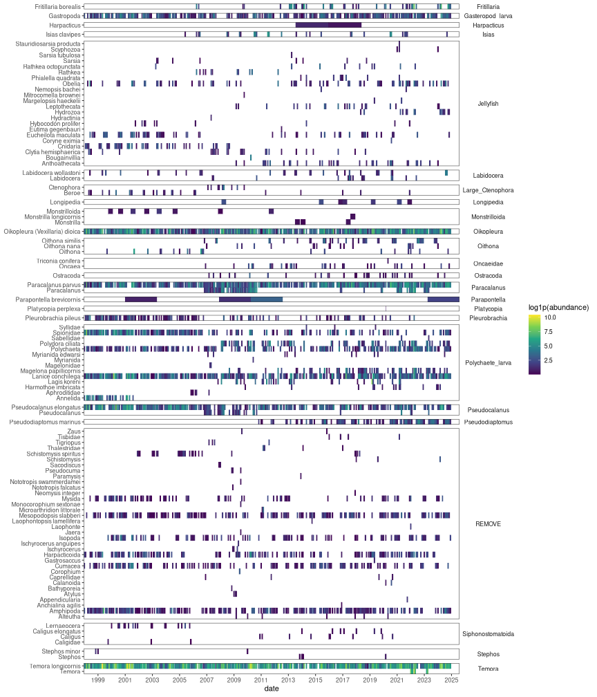
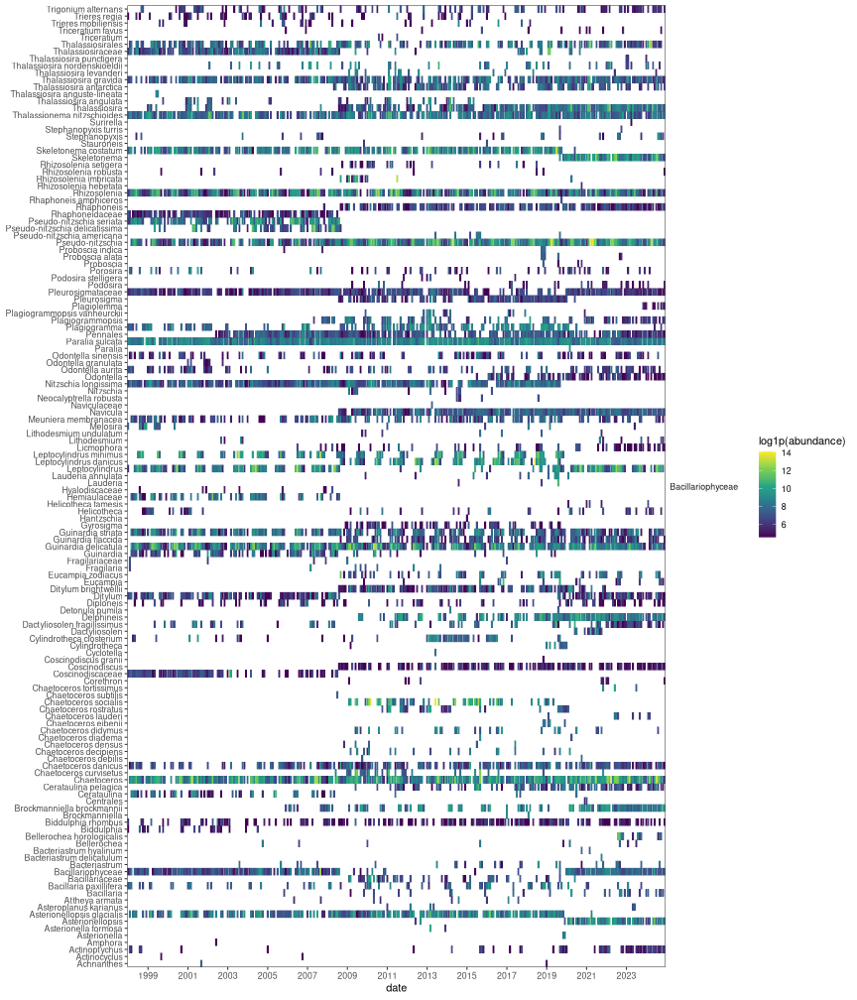
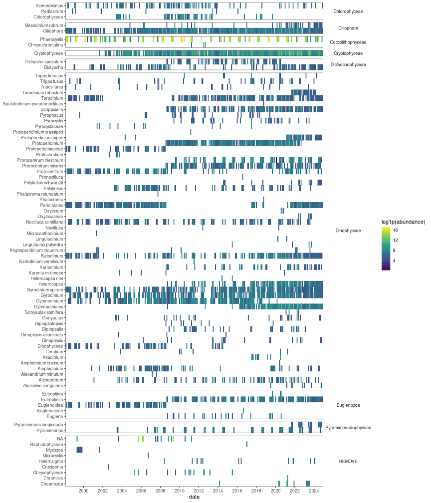

# Regroup some taxa in superior groups to minimize the effect of changing nomenclature
Lucien Bastin
2026-10-26

- [Libraries and data](#libraries-and-data)
  - [Libraries](#libraries)
  - [Data](#data)
- [Add group information to taxonomic
  data](#add-group-information-to-taxonomic-data)
- [Display timeseries of abundance for each taxa in their
  groups](#display-timeseries-of-abundance-for-each-taxa-in-their-groups)
  - [Plot for zooplankton](#plot-for-zooplankton)
  - [Plot for phytoplankton](#plot-for-phytoplankton)
- [Export data](#export-data)
- [Session info](#session-info)

# Libraries and data

## Libraries

``` r
library(conflicted)
library(dplyr)
library(ggh4x)
library(ggplot2)
library(here)
library(lubridate)
```

``` r
conflicted::conflict_scout()
```

    2 conflicts

    • `filter()`: dplyr and stats

    • `lag()`: dplyr and stats

``` r
conflicted::conflicts_prefer(
 dplyr::filter()
)
```

## Data

``` r
zooplankton_data <- read.csv(here("Data/Temp/zoo_with_taxo.csv"))
phytoplankton_data <- read.csv(here("Data/Temp/phyto_with_taxo.csv"))
```

``` r
zooplankton_groups <- read.csv(here("Data/Raw/zoo_groups.csv"))
phytoplankton_groups <- read.csv(here("Data/Raw/phyto_groups.csv"))
```

# Add group information to taxonomic data

``` r
zooplankton_data <- zooplankton_data |>
  left_join(zooplankton_groups) |>
  mutate(date = as.Date(date, format = "%Y-%m-%d"))

phytoplankton_data <- phytoplankton_data |>
  left_join(phytoplankton_groups) |>
  mutate(date = as.Date(date, format = "%Y-%m-%d"))
```

``` r
head(zooplankton_data)
```

| date | sample_no | taxo_id | unit | quality_flag | abundance | Kingdom | Phylum | Class | Order | Family | Genus | Species | lifecycle | superior_group |
|:---|:---|---:|:---|:---|---:|:---|:---|:---|:---|:---|:---|:---|:---|:---|
| 1998-01-07 | 5198701 | 101 | nr/m3 | S | 25.06964 | Animalia | Mollusca | Gastropoda | NA | NA | NA | NA | Meroplanktonic | Gasteropod_larva |
| 1998-01-07 | 5198701 | 882 | nr/m3 | S | 16.71309 | Animalia | Annelida | NA | NA | NA | NA | NA | Meroplanktonic | Polychaete_larva |
| 1998-01-07 | 5198701 | 913 | nr/m3 | S | 214.48468 | Animalia | Annelida | Polychaeta | Spionida | Spionidae | NA | NA | Meroplanktonic | Polychaete_larva |
| 1998-01-07 | 5198701 | 1082 | nr/m3 | S | 25.06964 | Animalia | Arthropoda | Thecostraca | NA | NA | NA | NA | Meroplanktonic | Cirriped_larva |
| 1998-01-07 | 5198701 | 1101 | nr/m3 | S | 97.49304 | Animalia | Arthropoda | Copepoda | Cyclopoida | NA | NA | NA | Holoplanktonic | Cyclopoida |
| 1998-01-07 | 5198701 | 1102 | nr/m3 | S | 13.92758 | Animalia | Arthropoda | Copepoda | Harpacticoida | NA | NA | NA | Benthic | REMOVE |

``` r
zooplankton_superior_groups <- data.frame(
  groups = sort(unique(zooplankton_groups$superior_group)),
  n_taxa_in_groups = zooplankton_groups |>
    group_by(superior_group) |>
    count() |>
    pull(n)
)

phytoplankton_superior_groups <- data.frame(
  groups = sort(unique(phytoplankton_groups$superior_group)),
  n_taxa_in_groups = phytoplankton_groups |>
    group_by(superior_group) |>
    count() |>
    pull(n)
)
```

``` r
head(zooplankton_superior_groups)
```

| groups         | n_taxa_in_groups |
|:---------------|-----------------:|
| Acartiidae     |                4 |
| Ascidiacea     |                1 |
| Bivalvia_larva |                1 |
| Branchiopoda   |                7 |
| Bryozoan_larva |                2 |
| Calanus        |                2 |

# Display timeseries of abundance for each taxa in their groups

Add a column with the best available taxonomic information

``` r
zooplankton_data <- zooplankton_data |>
  rowwise() |>
  mutate(
    best_taxo = {
      vals <- c_across(Kingdom:Species)
      non_na_vals <- vals[!is.na(vals)]
      if (length(non_na_vals) == 0) NA else tail(non_na_vals, 1)
    }
  )

phytoplankton_data <- phytoplankton_data |>
  rowwise() |>
  mutate(
    best_taxo = {
      vals <- c_across(Kingdom:Species)
      non_na_vals <- vals[!is.na(vals)]
      if (length(non_na_vals) == 0) NA else tail(non_na_vals, 1)
    }
  )
```

``` r
head(zooplankton_data)
```

| date | sample_no | taxo_id | unit | quality_flag | abundance | Kingdom | Phylum | Class | Order | Family | Genus | Species | lifecycle | superior_group | best_taxo |
|:---|:---|---:|:---|:---|---:|:---|:---|:---|:---|:---|:---|:---|:---|:---|:---|
| 1998-01-07 | 5198701 | 101 | nr/m3 | S | 25.06964 | Animalia | Mollusca | Gastropoda | NA | NA | NA | NA | Meroplanktonic | Gasteropod_larva | Gastropoda |
| 1998-01-07 | 5198701 | 882 | nr/m3 | S | 16.71309 | Animalia | Annelida | NA | NA | NA | NA | NA | Meroplanktonic | Polychaete_larva | Annelida |
| 1998-01-07 | 5198701 | 913 | nr/m3 | S | 214.48468 | Animalia | Annelida | Polychaeta | Spionida | Spionidae | NA | NA | Meroplanktonic | Polychaete_larva | Spionidae |
| 1998-01-07 | 5198701 | 1082 | nr/m3 | S | 25.06964 | Animalia | Arthropoda | Thecostraca | NA | NA | NA | NA | Meroplanktonic | Cirriped_larva | Thecostraca |
| 1998-01-07 | 5198701 | 1101 | nr/m3 | S | 97.49304 | Animalia | Arthropoda | Copepoda | Cyclopoida | NA | NA | NA | Holoplanktonic | Cyclopoida | Cyclopoida |
| 1998-01-07 | 5198701 | 1102 | nr/m3 | S | 13.92758 | Animalia | Arthropoda | Copepoda | Harpacticoida | NA | NA | NA | Benthic | REMOVE | Harpacticoida |

Compute mean abundance per month for each taxa

``` r
zooplankton_data_monthly <- zooplankton_data |>
  mutate(year = year(date), month = month(date)) |>
  group_by(year, month, best_taxo, superior_group) |>
  summarize(across(abundance, mean)) |>
  ungroup() |>
  mutate(date = ymd(paste(year, month, "01")))

phytoplankton_data_monthly <- phytoplankton_data |>
  mutate(year = year(date), month = month(date)) |>
  group_by(year, month, best_taxo, superior_group) |>
  summarize(across(abundance, mean)) |>
  ungroup() |>
  mutate(date = ymd(paste(year, month, "01")))
```

``` r
head(zooplankton_data_monthly)
```

| year | month | best_taxo             | superior_group   | abundance | date       |
|-----:|------:|:----------------------|:-----------------|----------:|:-----------|
| 1998 |     1 | Acartia clausi        | Acartiidae       | 82.728914 | 1998-01-01 |
| 1998 |     1 | Amphipoda             | REMOVE           | 13.789819 | 1998-01-01 |
| 1998 |     1 | Annelida              | Polychaete_larva | 16.713092 | 1998-01-01 |
| 1998 |     1 | Bryozoa               | Bryozoan_larva   |  3.065515 | 1998-01-01 |
| 1998 |     1 | Calanus helgolandicus | Calanus          |  1.532758 | 1998-01-01 |
| 1998 |     1 | Centropages hamatus   | Centropages      |  2.317047 | 1998-01-01 |

Function to plot the grouping

``` r
plot_plankton_grouping <- function(
  data,
  all_superior_groups,
  first_group,
  last_group
) {
  data <- data |>
    filter(
      superior_group %in% all_superior_groups$groups[first_group:last_group]
    )

  ggplot(data, aes(x = date, y = best_taxo)) +
    geom_tile(aes(fill = log1p(abundance), color = log1p(abundance))) +
    facet_wrap(
      vars(superior_group),
      scales = "free_y",
      ncol = 1,
      strip.position = 'right'
    ) +
    force_panelsizes(
      rows = all_superior_groups$n_taxa_in_groups[first_group:last_group]
    ) +
    scale_x_date(expand = c(0, 0), date_breaks = "2 year", date_label = "%Y") +
    scale_y_discrete(expand = c(0, 0)) +
    scale_fill_viridis_c() +
    scale_color_viridis_c() +
    theme_bw() +
    theme(
      panel.grid = element_blank(),
      strip.background = element_blank(),
      strip.text.y = element_text(angle = 0),
      strip.placement = "outside",
      axis.title.y = element_blank()
    )
}
```

## Plot for zooplankton

``` r
plot_plankton_grouping(zooplankton_data_monthly, zooplankton_superior_groups, 1, 20)
```



``` r
plot_plankton_grouping(zooplankton_data_monthly, zooplankton_superior_groups, 21, 44)
```



## Plot for phytoplankton

``` r
plot_plankton_grouping(phytoplankton_data_monthly, phytoplankton_superior_groups, 1, 1)
```



``` r
plot_plankton_grouping(phytoplankton_data_monthly, phytoplankton_superior_groups, 2, 10)
```



# Export data

``` r
zooplankton_data_grouped <- zooplankton_data |>
  group_by(date, superior_group, quality_flag) |>
  summarize(across(abundance, sum))

phytoplankton_data_grouped <- phytoplankton_data |>
  group_by(date, superior_group, quality_flag) |>
  summarize(across(abundance, sum))
```

``` r
head(zooplankton_data_grouped)
```

| date       | superior_group | quality_flag |   abundance |
|:-----------|:---------------|:-------------|------------:|
| 1998-01-07 | Acartiidae     | S            | 150.4178273 |
| 1998-01-07 | Bryozoan_larva | S            |   5.5710306 |
| 1998-01-07 | Calanus        | S            |   2.7855153 |
| 1998-01-07 | Centropages    | A            |   0.1740947 |
| 1998-01-07 | Chaetognatha   | S            |   2.7855153 |
| 1998-01-07 | Cirriped_larva | S            |  25.0696379 |

``` r
write.csv(
  zooplankton_data_grouped,
  here("Data/Temp/zoo_grouped.csv"),
  row.names = FALSE
)

write.csv(
  phytoplankton_data_grouped,
  here("Data/Temp/phyto_grouped.csv"),
  row.names = FALSE
)
```

# Session info

``` r
sessionInfo()
```

    R version 4.6.1 (2026-06-24)
    Platform: x86_64-redhat-linux-gnu
    Running under: Fedora Linux 44 (COSMIC)

    Matrix products: default
    BLAS/LAPACK: FlexiBLAS OPENBLAS-OPENMP;  LAPACK version 3.12.1

    locale:
     [1] LC_CTYPE=en_US.UTF-8       LC_NUMERIC=C              
     [3] LC_TIME=en_US.UTF-8        LC_COLLATE=en_US.UTF-8    
     [5] LC_MONETARY=en_US.UTF-8    LC_MESSAGES=en_US.UTF-8   
     [7] LC_PAPER=en_US.UTF-8       LC_NAME=C                 
     [9] LC_ADDRESS=C               LC_TELEPHONE=C            
    [11] LC_MEASUREMENT=en_US.UTF-8 LC_IDENTIFICATION=C       

    time zone: Europe/Paris
    tzcode source: system (glibc)

    attached base packages:
    [1] stats     graphics  grDevices datasets  utils     methods   base     

    other attached packages:
    [1] lubridate_1.9.5  here_1.0.2       ggh4x_0.3.1      ggplot2_4.0.3   
    [5] dplyr_1.2.1      conflicted_1.2.0

    loaded via a namespace (and not attached):
     [1] gtable_0.3.6       jsonlite_2.0.0     compiler_4.6.1     renv_1.3.1        
     [5] tidyselect_1.2.1   scales_1.4.0       yaml_2.3.12        fastmap_1.2.0     
     [9] R6_2.6.1           labeling_0.4.3     generics_0.1.4     knitr_1.52        
    [13] tibble_3.3.1       rprojroot_2.1.1    pillar_1.11.1      RColorBrewer_1.1-3
    [17] rlang_1.3.0        cachem_1.1.0       xfun_0.62          S7_0.2.2          
    [21] viridisLite_0.4.3  timechange_0.4.0   memoise_2.0.1      cli_3.6.6         
    [25] withr_3.0.3        magrittr_2.0.5     digest_0.6.39      grid_4.6.1        
    [29] lifecycle_1.0.5    vctrs_0.7.3        evaluate_1.0.5     glue_1.8.1        
    [33] farver_2.1.2       rmarkdown_2.32     tools_4.6.1        pkgconfig_2.0.3   
    [37] htmltools_0.5.9   
