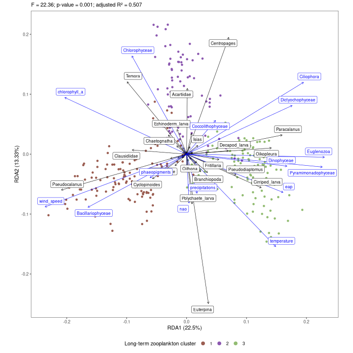
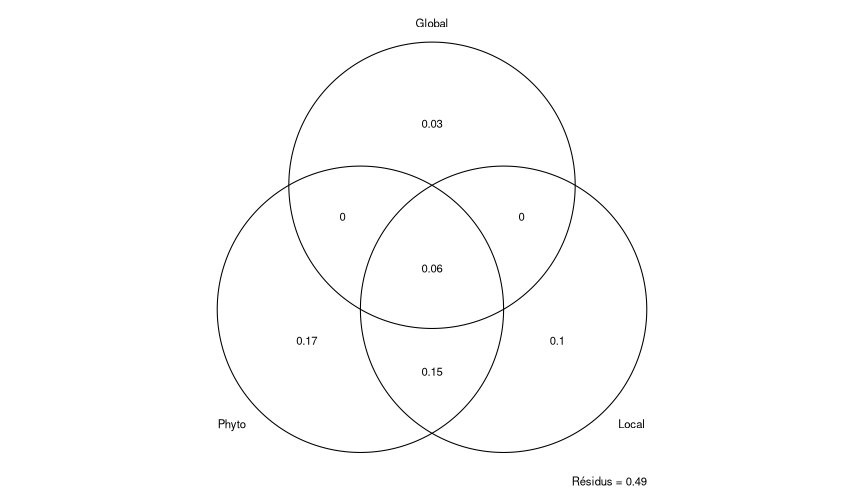

# Quantify the effect of environmental and phytoplanktonic stressors on the zooplankton community composition
Lucien Bastin
2026-11-05

- [Libraries and data](#libraries-and-data)
  - [Libraries](#libraries)
  - [Functions](#functions)
  - [Data](#data)
- [Redundancy analysis (RDA)](#redundancy-analysis-rda)
  - [Data preparation](#data-preparation)
  - [Perform RDA](#perform-rda)
- [Plot RDA outputs](#plot-rda-outputs)
  - [Ordination](#ordination)
  - [Variance partitioning](#variance-partitioning)
- [Session info](#session-info)

# Libraries and data

## Libraries

``` r
library(adespatial)
library(conflicted)
library(dplyr)
library(ggforce)
library(ggplot2)
library(ggrepel)
library(here)
library(vegan)
```

``` r
conflicted::conflict_scout()
```

    2 conflicts

    • `filter()`: dplyr and stats

    • `lag()`: dplyr and stats

## Functions

``` r
source(here("R/extract_rda_data.R"))
source(here("R/palettes.R"))
```

## Data

``` r
zooplankton_deseasonalized <- read.csv(here("Data/Temp/zoo_deseasonalized.csv"))
phytoplankton_deseasonalized <- read.csv(here("Data/Temp/phyto_deseasonalized.csv"))
environment_deseasonalized <- read.csv(here("Data/Temp/env_deseasonalized.csv"))
```

``` r
zooplankton_clusters <- read.csv(here("Data/Temp/zooplankton_longterm_clusters.csv")) |>
  mutate(date = as.Date(date), cluster = factor(cluster))
```

# Redundancy analysis (RDA)

## Data preparation

We will discriminate the environmental variables between “local”
(variables that were measured locally on the sampling site) and “global”
(NAO and EAP which affect the Northern Atlantic as a whole).

``` r
local_environment <- environment_deseasonalized |>
  select(date, temperature, chlorophyll_a, phaeopigments, wind_speed, precipitations)

global_environment <- environment_deseasonalized |>
  select(date, nao, eap)
```

For now we can group all three datasets (plankton, local environment and
global environment) together.

``` r
stressors <- phytoplankton_deseasonalized |>
  left_join(local_environment) |>
  left_join(global_environment)
```

``` r
head(stressors)
```

| date | Bacillariophyceae | Chlorophyceae | Ciliophora | Coccolithophyceae | Cryptophyceae | Dictyochophyceae | Dinophyceae | Euglenozoa | Pyramimonadophyceae | temperature | chlorophyll_a | phaeopigments | wind_speed | precipitations | nao | eap |
|:---|---:|---:|---:|---:|---:|---:|---:|---:|---:|---:|---:|---:|---:|---:|---:|---:|
| 1998-07-01 | 0.7884502 | 0.0083655 | 0.0276014 | 0.2544116 | 0 | 0.0000000 | 0.0613533 | 0.0177533 | 0 | 12.67000 | 5.305500 | 0.926625 | 6.333333 | 57.76667 | -0.0683333 | 0.5900000 |
| 1998-08-01 | 0.7883423 | 0.0083655 | 0.0297210 | 0.2544116 | 0 | 0.0021195 | 0.0643507 | 0.0177533 | 0 | 12.67417 | 5.246333 | 0.977875 | 6.300000 | 57.41667 | 0.0733333 | 0.5558333 |
| 1998-09-01 | 0.7881422 | 0.0132866 | 0.0310688 | 0.2544116 | 0 | 0.0034674 | 0.0666853 | 0.0177533 | 0 | 12.66583 | 5.270500 | 1.048917 | 6.500000 | 58.26667 | 0.1158333 | 0.3083333 |
| 1998-10-01 | 0.8163278 | 0.0165038 | 0.0306086 | 0.2428993 | 0 | 0.0034674 | 0.0674050 | 0.0177533 | 0 | 12.63083 | 5.056500 | 1.090917 | 6.416667 | 58.38333 | -0.0066667 | 0.1000000 |
| 1998-11-01 | 0.8230275 | 0.0165038 | 0.0301881 | 0.2423049 | 0 | 0.0034674 | 0.0676727 | 0.0176522 | 0 | 12.68917 | 6.327750 | 1.380292 | 6.458333 | 58.75000 | 0.0025000 | -0.0150000 |
| 1998-12-01 | 0.8119042 | 0.0148342 | 0.0279556 | 0.2449416 | 0 | 0.0034674 | 0.0670299 | 0.0176522 | 0 | 12.71625 | 6.832125 | 1.586958 | 6.541667 | 63.03333 | 0.0116667 | 0.1233333 |

## Perform RDA

For the RDA function, we need to remove the date column from the
datasets. We also make sure that the zooplankton and the stressors
datasets are both ordered in the same way (here by date).

``` r
zooplankton_for_rda <- zooplankton_deseasonalized |>
  arrange(date) |>
  select(-date)

stressors_for_rda <- stressors |>
  arrange(date) |>
  select(-date)
```

``` r
rda <- rda(zooplankton_for_rda ~ ., stressors_for_rda)
```

``` r
rda_forward_selection <- forward.sel(
  zooplankton_for_rda,
  stressors_for_rda,
  adjR2thresh = RsquareAdj(rda)$adj.r.squared
)
```

    Testing variable 1
    Testing variable 2
    Testing variable 3
    Testing variable 4
    Testing variable 5
    Testing variable 6
    Testing variable 7
    Testing variable 8
    Testing variable 9
    Testing variable 10
    Testing variable 11
    Testing variable 12
    Testing variable 13
    Testing variable 14
    Testing variable 15
    Testing variable 16
    Procedure stopped (adjR2thresh criteria) adjR2cum = 0.513843 with 16 variables (> 0.513843)

``` r
rda <- rda(
  zooplankton_for_rda ~ .,
  stressors_for_rda[rda_forward_selection$order]
)
```

# Plot RDA outputs

## Ordination

``` r
rda_data <- rda |>
  extract_rda_data(min_goodness = 0)
```

``` r
ggplot() +
  geom_point(
    data = rda_data$sites_scores,
    aes(
      x = RDA1,
      y = RDA2,
      color = zooplankton_clusters$cluster
    )
  ) +
  geom_segment(
    data = rda_data$species_scores,
    aes(
      x = 0,
      y = 0,
      xend = RDA1,
      yend = RDA2
    ),
    arrow = arrow(length = unit(.15, 'cm')),
    color = "black",
    lwd = 0.3,
  ) +
  geom_segment(
    data = rda_data$env_scores,
    aes(
      x = 0,
      y = 0,
      xend = RDA1,
      yend = RDA2
    ),
    arrow = arrow(length = unit(.15, 'cm')),
    color = "blue",
    lwd = 0.3
  ) +
  geom_label_repel(
    data = rda_data$species_scores,
    aes(x = RDA1, y = RDA2, label = species),
    color = "black",
    size = 3
  ) +
  geom_label_repel(
    data = rda_data$env_scores,
    aes(
      x = RDA1,
      y = RDA2,
      label = env
    ),
    color = "blue",
    size = 3
  ) +
  labs(
    x = paste0("RDA1 (", rda_data$var_perc[1], "%)"),
    y = paste0("RDA2 (", rda_data$var_perc[2], "%)"),
    subtitle = paste0(
      "F = ",
      rda_data$F,
      "; p-value = ",
      rda_data$p_value,
      "; adjusted R² = ",
      rda_data$r_sq_adj
    )
  ) +
  scale_color_manual(values = zooplankton_longterm_clusters_palette) +
  labs(color = "Long-term zooplankton cluster") +
  coord_fixed() +
  guides(color = guide_legend(override.aes = list(size = 3))) +
  theme_bw() +
  theme(
    panel.grid.major = element_blank(),
    panel.grid.minor = element_blank(),
    legend.position = "bottom"
  )
```



## Variance partitioning

``` r
selected_vars <- rda_forward_selection$variables

varpart_zoo <- varpart(
  zooplankton_for_rda,
  phytoplankton_deseasonalized |> select(any_of(selected_vars)),
  local_environment |> select(any_of(selected_vars)),
  global_environment |> select(any_of(selected_vars))
)

varpart_fractions <- as.data.frame(varpart_zoo$part$indfract)$Adj.R.square
```

``` r
radius <- 1
txt_size <- 4

parts <- round(pmax(0, varpart_fractions), 2)

circles <- data.frame(
  x = c(0, radius, radius / 2),
  y = c(0, 0, radius * sqrt(3) / 2),
  fill = c("A", "B", "C")
)

names <- data.frame(
  x = c(-radius + 0.2, 2 * radius - 0.2, radius / 2),
  y = c(-radius + 0.2, -radius + 0.2, 2 * radius),
  label = c("Phyto", "Local", "Global"),
  hjust = c(1, 0, 0.5)
)

values <- data.frame(
  x = c(-3 / 8, 1 + 3 / 8, 0.5, 0.5, (1 + 0.5) * 3 / 4, -0.5 * 1 / 4, 0.5),
  y = c(
    -sqrt(3) / 8,
    -sqrt(3) / 8,
    radius * sqrt(3) / 2 + 0.433,
    -sqrt(3) / 4,
    sqrt(3) / 2 * 3 / 4,
    sqrt(3) / 2 * 3 / 4,
    sqrt(3) / 6
  ),
  label = parts[1:7]
)
```

``` r
ggplot() +
  geom_text(
    data = names,
    aes(x = x, y = y, label = label, hjust = hjust),
    size = txt_size
  ) +
  geom_circle(
    data = circles,
    aes(x0 = x, y0 = y, r = 1)
  ) +
  geom_text(
    data = values,
    aes(x = x, y = y, label = label),
    size = txt_size
  ) +
  annotate(
    "text",
    x = 2,
    y = -1.2,
    label = paste0("Résidus = ", parts[8]),
    size = txt_size,
    hjust = "right"
  ) +
  scale_x_continuous(expand = expansion(mult = 0.2)) +
  coord_fixed() +
  theme_void()
```



# Session info

``` r
sessionInfo()
```

    R version 4.6.1 (2026-06-24)
    Platform: x86_64-redhat-linux-gnu
    Running under: Fedora Linux 44 (COSMIC)

    Matrix products: default
    BLAS/LAPACK: FlexiBLAS OPENBLAS-OPENMP;  LAPACK version 3.12.1

    locale:
     [1] LC_CTYPE=en_US.UTF-8       LC_NUMERIC=C              
     [3] LC_TIME=en_US.UTF-8        LC_COLLATE=en_US.UTF-8    
     [5] LC_MONETARY=en_US.UTF-8    LC_MESSAGES=en_US.UTF-8   
     [7] LC_PAPER=en_US.UTF-8       LC_NAME=C                 
     [9] LC_ADDRESS=C               LC_TELEPHONE=C            
    [11] LC_MEASUREMENT=en_US.UTF-8 LC_IDENTIFICATION=C       

    time zone: Europe/Paris
    tzcode source: system (glibc)

    attached base packages:
    [1] stats     graphics  grDevices datasets  utils     methods   base     

    other attached packages:
     [1] hues_0.2.0        tibble_3.3.1      vegan_2.7-6       permute_0.9-10   
     [5] here_1.0.2        ggrepel_0.9.8     ggforce_0.5.0     ggplot2_4.0.3    
     [9] dplyr_1.2.1       conflicted_1.2.0  adespatial_0.3-30

    loaded via a namespace (and not attached):
     [1] ade4_1.7-24         tidyselect_1.2.1    farver_2.1.2       
     [4] S7_0.2.2            fastmap_1.2.0       tweenr_2.0.3       
     [7] promises_1.5.0      XML_3.99-0.25       digest_0.6.39      
    [10] mime_0.13           lifecycle_1.0.5     sf_1.1-3           
    [13] cluster_2.1.8.2     magrittr_2.0.5      compiler_4.6.1     
    [16] rlang_1.3.0         progress_1.2.3      tools_4.6.1        
    [19] igraph_2.3.4        yaml_2.3.12         knitr_1.52         
    [22] labeling_0.4.3      prettyunits_1.2.0   interp_1.1-6       
    [25] sp_2.2-4            classInt_0.4-11     plyr_1.8.9         
    [28] xml2_1.6.0          RColorBrewer_1.1-3  RNeXML_2.4.11      
    [31] KernSmooth_2.23-26  withr_3.0.3         purrr_1.2.2        
    [34] polyclip_1.10-7     grid_4.6.1          latticeExtra_0.6-31
    [37] colorspace_2.1-4    xtable_1.8-8        e1071_1.7-17       
    [40] scales_1.4.0        MASS_7.3-65         cli_3.6.6          
    [43] rmarkdown_2.32      crayon_1.5.3        generics_0.1.4     
    [46] otel_0.2.0          httr_1.4.9          reshape2_1.4.5     
    [49] spdep_1.4-2         cachem_1.1.0        proxy_0.4-29       
    [52] DBI_1.3.0           ape_5.8-1           stringr_1.6.0      
    [55] splines_4.6.1       parallel_4.6.1      s2_1.1.13          
    [58] adegraphics_1.0-22  vctrs_0.7.3         boot_1.3-32        
    [61] Matrix_1.7-5        jsonlite_2.0.0      spData_2.3.5       
    [64] hms_1.1.4           phylobase_0.8.12    seqinr_4.2-44      
    [67] jpeg_0.1-11         tidyr_1.3.2         units_1.0-1        
    [70] glue_1.8.1          stringi_1.8.9       gtable_0.3.6       
    [73] later_1.4.8         deldir_2.0-4        pillar_1.11.1      
    [76] htmltools_0.5.9     R6_2.6.1            wk_0.9.5           
    [79] rprojroot_2.1.1     evaluate_1.0.5      shiny_1.14.0       
    [82] lattice_0.22-9      png_0.1-9           memoise_2.0.1      
    [85] renv_1.3.1          httpuv_1.6.17       class_7.3-23       
    [88] adegenet_2.1.11     Rcpp_1.1.2          rncl_0.8.10        
    [91] uuid_1.2-2          nlme_3.1-169        mgcv_1.9-4         
    [94] xfun_0.62           adephylo_1.1-17     pkgconfig_2.0.3    

Document rendered using Quarto version 1.10.18.
