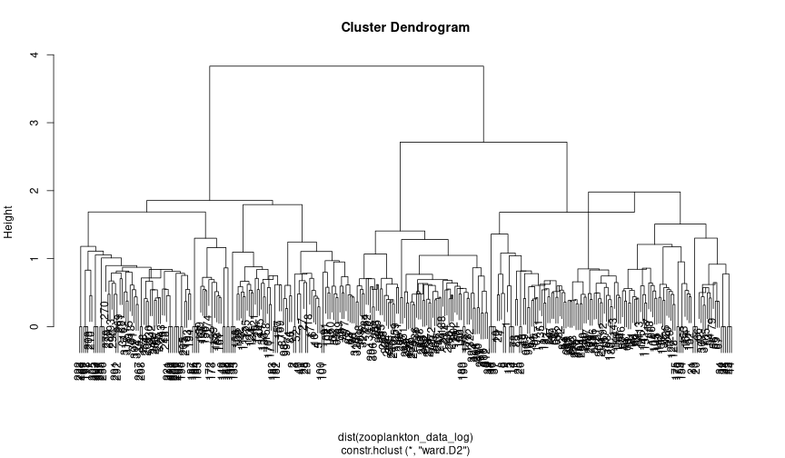
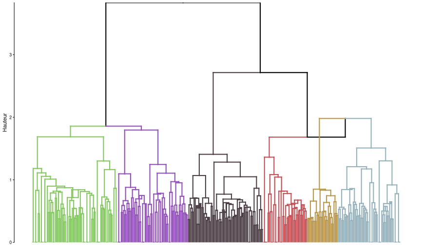
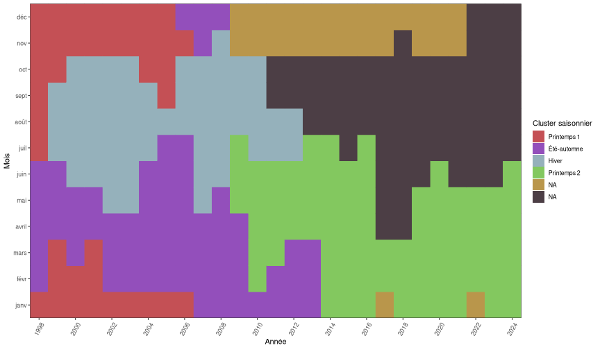
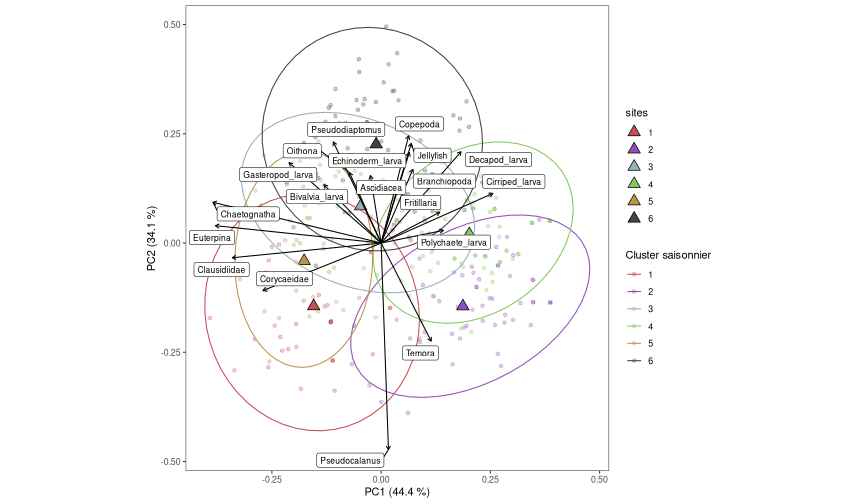

# Identify seasonal clusters in the plankton timeseries
Lucien Bastin
2026-11-04

- [Libraries and data](#libraries-and-data)
  - [Libraries](#libraries)
  - [Functions](#functions)
  - [Data](#data)
- [Prepare data](#prepare-data)
- [Compute links matrix](#compute-links-matrix)
- [Perform clustering](#perform-clustering)
- [Seasonal PCA](#seasonal-pca)
- [Session info](#session-info)

# Libraries and data

## Libraries

``` r
library(adespatial)
library(conflicted)
library(dendextend)
library(dplyr)
library(ggplot2)
library(ggrepel)
library(here)
library(hues)
library(lubridate)
library(vegan)
```

``` r
conflicted::conflict_scout()
```

    3 conflicts

    • `filter()`: dplyr and stats

    • `lag()`: dplyr and stats

    • `shuffle()`: permute and dendextend

``` r
conflicted::conflicts_prefer(dplyr::filter())
```

## Functions

``` r
source(here("R/extract_pca_data.R"))
```

## Data

``` r
zooplankton_data <- read.csv(here("Data/Temp/zoo_regularized.csv"))
```

# Prepare data

``` r
zooplankton_data_log <- zooplankton_data |>
  mutate(across(-date, log1p)) |>
  select(-date) |>
  decostand("hellinger") |>
  mutate(date = zooplankton_data$date, .before = everything())
```

# Compute links matrix

``` r
dates_links <- zooplankton_data |>
  mutate(origin = row_number(), target = lead(origin, 1)) |>
  select(origin, target) |>
  na.omit()

months_links <- zooplankton_data |>
  mutate(date_n = row_number()) |>
  group_by(month = month(date)) |>
  arrange(month) |>
  mutate(origin = date_n, target = lead(date_n, 1)) |>
  ungroup() |>
  na.omit() |>
  select(origin, target)

links <- rbind(dates_links, months_links)
```

# Perform clustering

``` r
clust <- constr.hclust(dist(zooplankton_data_log), links = links)
plot(clust)
```



``` r
n_clusters <- 6
```

``` r
dend <- as.dendrogram(clust)
zoo_dend_clusters <- cutree(clust, k = n_clusters)[order.dendrogram(dend)]

zoo_season_dendro <- dend |>
  color_branches(
    clusters = zoo_dend_clusters,
    col = iwanthue(n_clusters)[unique(zoo_dend_clusters)]
  ) |>
  as.ggdend() |>
  ggplot(labels = FALSE) +
  scale_y_continuous(expand = c(0, 0)) +
  labs(y = "Hauteur") +
  theme_classic() +
  theme(
    axis.line.x = element_blank(),
    axis.text.x = element_blank(),
    axis.ticks.x = element_blank(),
    axis.title.x = element_blank()
  )

zoo_season_dendro
```



``` r
clustering <- cutree(clust, k = n_clusters)
zooplankton_season_pal <- iwanthue(n_clusters)
```

``` r
zoo_cluster_plot <- ggplot(
  zooplankton_data_log,
  aes(
    x = year(date),
    y = month(date, label = TRUE, locale = "fr_FR.utf8"),
    fill = as.factor(clustering),
    color = as.factor(clustering)
  )
) +
  geom_tile() +
  scale_x_continuous(
    expand = c(0, 0),
    breaks = unique(year(zooplankton_data_log$date))[c(TRUE, FALSE)]
  ) +
  scale_y_discrete(expand = c(0, 0)) +
  scale_fill_manual(
    values = zooplankton_season_pal,
    labels = c("Printemps 1", "Été-automne", "Hiver", "Printemps 2")
  ) +
  scale_color_manual(values = zooplankton_season_pal) +
  labs(x = "Année", y = "Mois", fill = "Cluster saisonnier") +
  guides(color = "none") +
  theme_bw() +
  theme(axis.text.x = element_text(angle = 60, vjust = 0.5))

zoo_cluster_plot
```



# Seasonal PCA

``` r
project_points_on_PCA <- function(points, clusters, pca) {
  newpoints_scaled <- points |>
    mutate(across(
      everything(),
      ~ . - colMeans(clusters)[cur_column()]
    ))

  newpoints_projected <- as.data.frame(as.matrix(newpoints_scaled) %*% pca$CA$v)
}
```

``` r
zoo_clusters <- zooplankton_data_log |>
  group_by(cluster = clustering) |>
  summarize(across(-date, mean)) |>
  select(-cluster)
```

``` r
zoo_seasonal_pca <- zoo_clusters |>
  rda()
```

``` r
pca_data <- zoo_seasonal_pca |>
  extract_pca_data()

centroids <- pca_data$sites_scores
```

``` r
projected_points <- project_points_on_PCA(
  zooplankton_data_log[-1],
  zoo_clusters,
  zoo_seasonal_pca
) |>
  mutate(cluster = clustering)
```

``` r
plot_seasonal_PCA <- function(
  projected_points,
  centroids,
  pca_data,
  palette,
  tresh = 0
) {
  ggplot() +
    geom_point(
      data = projected_points,
      aes(x = PC1, y = PC2, color = as.character(cluster)),
      alpha = 0.3
    ) +
    geom_point(
      data = centroids,
      aes(
        x = PC1,
        y = PC2,
        fill = sites
      ),
      color = "black",
      shape = 24,
      size = 4
    ) +
    stat_ellipse(
      data = projected_points,
      aes(
        x = PC1,
        y = PC2,
        color = as.character(cluster)
      )
    ) +
    geom_segment(
      data = pca_data$species_scores |> filter(sqrt(PC1**2 + PC2**2) > tresh),
      aes(x = 0, xend = PC1 * 2, y = 0, yend = PC2 * 2),
      arrow = arrow(length = unit(.15, 'cm'))
    ) +
    geom_label_repel(
      data = pca_data$species_scores |> filter(sqrt(PC1**2 + PC2**2) > tresh),
      aes(x = PC1 * 2, y = PC2 * 2, label = species),
      max.overlaps = 10,
      size = 3
    ) +
    scale_color_manual(values = palette) +
    scale_fill_manual(values = palette) +
    scale_shape_manual(values = c(21, 22, 24)) +
    labs(
      x = paste0("PC1 (", pca_data$percent_var[1], " %)"),
      y = paste0("PC2 (", pca_data$percent_var[2], " %)"),
      color = "Cluster saisonnier"
    ) +
    coord_fixed() +
    theme_bw() +
    theme(
      panel.grid.major = element_blank(),
      panel.grid.minor = element_blank()
    )
}
```

``` r
zoo_pca_season <- plot_seasonal_PCA(
  projected_points,
  centroids,
  pca_data,
  zooplankton_season_pal,
  0.07
)
```

``` r
zoo_pca_season
```



# Session info

``` r
sessionInfo()
```

    R version 4.6.1 (2026-06-24)
    Platform: x86_64-redhat-linux-gnu
    Running under: Fedora Linux 44 (COSMIC)

    Matrix products: default
    BLAS/LAPACK: FlexiBLAS OPENBLAS-OPENMP;  LAPACK version 3.12.1

    locale:
     [1] LC_CTYPE=en_US.UTF-8       LC_NUMERIC=C              
     [3] LC_TIME=en_US.UTF-8        LC_COLLATE=en_US.UTF-8    
     [5] LC_MONETARY=en_US.UTF-8    LC_MESSAGES=en_US.UTF-8   
     [7] LC_PAPER=en_US.UTF-8       LC_NAME=C                 
     [9] LC_ADDRESS=C               LC_TELEPHONE=C            
    [11] LC_MEASUREMENT=en_US.UTF-8 LC_IDENTIFICATION=C       

    time zone: Europe/Paris
    tzcode source: system (glibc)

    attached base packages:
    [1] stats     graphics  grDevices datasets  utils     methods   base     

    other attached packages:
     [1] tibble_3.3.1      vegan_2.7-6       permute_0.9-10    lubridate_1.9.5  
     [5] hues_0.2.0        here_1.0.2        ggrepel_0.9.8     ggplot2_4.0.3    
     [9] dplyr_1.2.1       dendextend_1.19.1 conflicted_1.2.0  adespatial_0.3-30

    loaded via a namespace (and not attached):
     [1] DBI_1.3.0           deldir_2.0-4        gridExtra_2.3.1    
     [4] s2_1.1.13           rlang_1.3.0         magrittr_2.0.5     
     [7] ade4_1.7-24         otel_0.2.0          e1071_1.7-17       
    [10] compiler_4.6.1      mgcv_1.9-4          png_0.1-9          
    [13] vctrs_0.7.3         reshape2_1.4.5      stringr_1.6.0      
    [16] pkgconfig_2.0.3     wk_0.9.5            crayon_1.5.3       
    [19] fastmap_1.2.0       labeling_0.4.3      promises_1.5.0     
    [22] rmarkdown_2.32      purrr_1.2.2         xfun_0.62          
    [25] cachem_1.1.0        seqinr_4.2-44       jsonlite_2.0.0     
    [28] progress_1.2.3      later_1.4.8         adegenet_2.1.11    
    [31] uuid_1.2-2          jpeg_0.1-11         parallel_4.6.1     
    [34] prettyunits_1.2.0   cluster_2.1.8.2     R6_2.6.1           
    [37] stringi_1.8.9       RColorBrewer_1.1-3  boot_1.3-32        
    [40] Rcpp_1.1.2          knitr_1.52          adephylo_1.1-17    
    [43] httpuv_1.6.17       Matrix_1.7-5        adegraphics_1.0-22 
    [46] splines_4.6.1       igraph_2.3.4        timechange_0.4.0   
    [49] tidyselect_1.2.1    yaml_2.3.12         viridis_0.6.5      
    [52] phylobase_0.8.12    lattice_0.22-9      plyr_1.8.9         
    [55] shiny_1.14.0        withr_3.0.3         S7_0.2.2           
    [58] evaluate_1.0.5      sf_1.1-3            units_1.0-1        
    [61] spData_2.3.5        proxy_0.4-29        xml2_1.6.0         
    [64] pillar_1.11.1       KernSmooth_2.23-26  renv_1.3.1         
    [67] generics_0.1.4      rprojroot_2.1.1     sp_2.2-4           
    [70] hms_1.1.4           scales_1.4.0        xtable_1.8-8       
    [73] rncl_0.8.10         class_7.3-23        glue_1.8.1         
    [76] tools_4.6.1         interp_1.1-6        XML_3.99-0.25      
    [79] grid_4.6.1          spdep_1.4-2         tidyr_1.3.2        
    [82] ape_5.8-1           RNeXML_2.4.11       latticeExtra_0.6-31
    [85] colorspace_2.1-4    nlme_3.1-169        cli_3.6.6          
    [88] viridisLite_0.4.3   gtable_0.3.6        digest_0.6.39      
    [91] classInt_0.4-11     farver_2.1.2        memoise_2.0.1      
    [94] htmltools_0.5.9     lifecycle_1.0.5     httr_1.4.9         
    [97] mime_0.13           MASS_7.3-65        

Document rendered using Quarto version 1.10.18.
