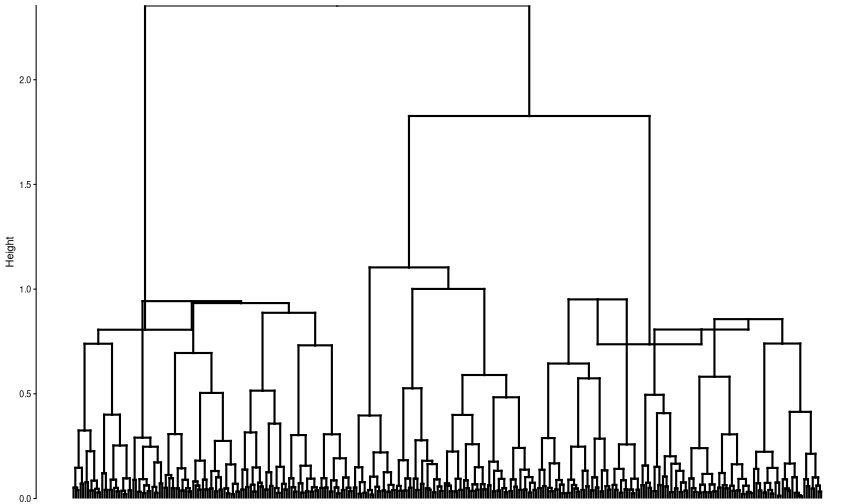
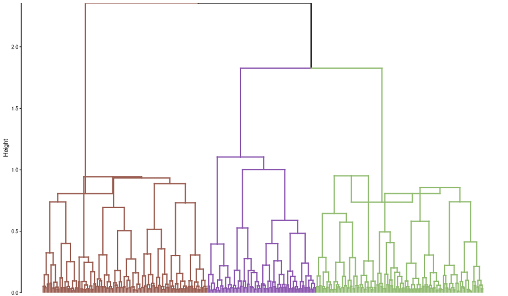

# Apply time-constrained clustering to the deseasonalized zooplankton timeseries
Lucien Bastin
2026-11-04

- [Libraries and data](#libraries-and-data)
  - [Libraries](#libraries)
  - [Scripts](#scripts)
  - [Data](#data)
- [Time-constrained clustering](#time-constrained-clustering)
  - [Apply the clustering](#apply-the-clustering)
  - [Visualize the clustering result as a
    dendrogram](#visualize-the-clustering-result-as-a-dendrogram)
- [Data export](#data-export)
- [Session info](#session-info)

# Libraries and data

## Libraries

``` r
library(adespatial)
library(conflicted)
library(dendextend)
library(dplyr)
library(ggplot2)
library(here)
```

``` r
conflicted::conflict_scout()
```

    2 conflicts

    • `filter()`: dplyr and stats

    • `lag()`: dplyr and stats

## Scripts

``` r
source(here("R/palettes.R"))
```

## Data

``` r
zooplankton_deseasonalized <- read.csv(here("Data/Temp/zoo_deseasonalized.csv"))
```

# Time-constrained clustering

## Apply the clustering

``` r
links <- data.frame(
  origin = seq(1:nrow(zooplankton_deseasonalized)),
  target = lead(seq(1:nrow(zooplankton_deseasonalized)), 1)
) |>
  na.omit()
```

``` r
head(links)
```

| origin | target |
|-------:|-------:|
|      1 |      2 |
|      2 |      3 |
|      3 |      4 |
|      4 |      5 |
|      5 |      6 |
|      6 |      7 |

``` r
clustering <- constr.hclust(
  dist(zooplankton_deseasonalized |> select(-date)),
  links = links
)
```

## Visualize the clustering result as a dendrogram

``` r
dendrogram <- as.dendrogram(clustering)

dendrogram_plot <- dendrogram |>
  dendextend::rotate(c(1:117, 196:313, 118:195)) |>
  as.ggdend() |>
  ggplot(labels = FALSE) +
  scale_y_continuous(expand = c(0, 0)) +
  labs(y = "Height") +
  theme_classic() +
  theme(
    axis.line.x = element_blank(),
    axis.text.x = element_blank(),
    axis.ticks.x = element_blank(),
    axis.title.x = element_blank()
  )
```

``` r
dendrogram_plot
```



It looks like three clusters would be a good fit

``` r
zoo_dend_clusters <- cutree(clustering, k = 3)[order.dendrogram(dendrogram)]

dendrogram_plot_colored <- dendrogram |>
  color_branches(
    clusters = zoo_dend_clusters,
    col = zooplankton_longterm_clusters_palette[unique(zoo_dend_clusters)]
  ) |>
  dendextend::rotate(c(1:117, 196:313, 118:195)) |>
  as.ggdend() |>
  ggplot(labels = FALSE) +
  scale_y_continuous(expand = c(0, 0)) +
  labs(y = "Height") +
  theme_classic() +
  theme(
    axis.line.x = element_blank(),
    axis.text.x = element_blank(),
    axis.ticks.x = element_blank(),
    axis.title.x = element_blank()
  )
```

``` r
dendrogram_plot_colored
```



# Data export

``` r
clusters <- data.frame(
  date = zooplankton_deseasonalized$date,
  cluster = as.character(cutree(clustering, 3))
)
```

``` r
write.csv(
  clusters,
  here("Data/Temp/zooplankton_longterm_clusters.csv"),
  row.names = FALSE
)
```

# Session info

``` r
sessionInfo()
```

    R version 4.6.1 (2026-06-24)
    Platform: x86_64-redhat-linux-gnu
    Running under: Fedora Linux 44 (COSMIC)

    Matrix products: default
    BLAS/LAPACK: FlexiBLAS OPENBLAS-OPENMP;  LAPACK version 3.12.1

    locale:
     [1] LC_CTYPE=en_US.UTF-8       LC_NUMERIC=C              
     [3] LC_TIME=en_US.UTF-8        LC_COLLATE=en_US.UTF-8    
     [5] LC_MONETARY=en_US.UTF-8    LC_MESSAGES=en_US.UTF-8   
     [7] LC_PAPER=en_US.UTF-8       LC_NAME=C                 
     [9] LC_ADDRESS=C               LC_TELEPHONE=C            
    [11] LC_MEASUREMENT=en_US.UTF-8 LC_IDENTIFICATION=C       

    time zone: Europe/Paris
    tzcode source: system (glibc)

    attached base packages:
    [1] stats     graphics  grDevices datasets  utils     methods   base     

    other attached packages:
    [1] hues_0.2.0        here_1.0.2        ggplot2_4.0.3     dplyr_1.2.1      
    [5] dendextend_1.19.1 conflicted_1.2.0  adespatial_0.3-30

    loaded via a namespace (and not attached):
      [1] ade4_1.7-24         tidyselect_1.2.1    viridisLite_0.4.3  
      [4] farver_2.1.2        viridis_0.6.5       S7_0.2.2           
      [7] fastmap_1.2.0       promises_1.5.0      XML_3.99-0.25      
     [10] digest_0.6.39       mime_0.13           lifecycle_1.0.5    
     [13] sf_1.1-3            cluster_2.1.8.2     magrittr_2.0.5     
     [16] compiler_4.6.1      rlang_1.3.0         progress_1.2.3     
     [19] tools_4.6.1         igraph_2.3.4        yaml_2.3.12        
     [22] knitr_1.52          labeling_0.4.3      prettyunits_1.2.0  
     [25] interp_1.1-6        sp_2.2-4            classInt_0.4-11    
     [28] plyr_1.8.9          xml2_1.6.0          RColorBrewer_1.1-3 
     [31] RNeXML_2.4.11       KernSmooth_2.23-26  withr_3.0.3        
     [34] purrr_1.2.2         grid_4.6.1          latticeExtra_0.6-31
     [37] colorspace_2.1-4    xtable_1.8-8        e1071_1.7-17       
     [40] scales_1.4.0        MASS_7.3-65         cli_3.6.6          
     [43] rmarkdown_2.32      vegan_2.7-6         crayon_1.5.3       
     [46] generics_0.1.4      otel_0.2.0          httr_1.4.9         
     [49] reshape2_1.4.5      spdep_1.4-2         cachem_1.1.0       
     [52] proxy_0.4-29        DBI_1.3.0           ape_5.8-1          
     [55] stringr_1.6.0       splines_4.6.1       parallel_4.6.1     
     [58] s2_1.1.13           adegraphics_1.0-22  vctrs_0.7.3        
     [61] boot_1.3-32         Matrix_1.7-5        jsonlite_2.0.0     
     [64] spData_2.3.5        hms_1.1.4           phylobase_0.8.12   
     [67] seqinr_4.2-44       jpeg_0.1-11         tidyr_1.3.2        
     [70] units_1.0-1         glue_1.8.1          stringi_1.8.9      
     [73] gtable_0.3.6        later_1.4.8         deldir_2.0-4       
     [76] tibble_3.3.1        pillar_1.11.1       htmltools_0.5.9    
     [79] R6_2.6.1            wk_0.9.5            rprojroot_2.1.1    
     [82] evaluate_1.0.5      shiny_1.14.0        lattice_0.22-9     
     [85] png_0.1-9           memoise_2.0.1       renv_1.3.1         
     [88] httpuv_1.6.17       class_7.3-23        adegenet_2.1.11    
     [91] Rcpp_1.1.2          rncl_0.8.10         uuid_1.2-2         
     [94] gridExtra_2.3.1     nlme_3.1-169        permute_0.9-10     
     [97] mgcv_1.9-4          xfun_0.62           adephylo_1.1-17    
    [100] pkgconfig_2.0.3    

Document rendered using Quarto version 1.10.18.
