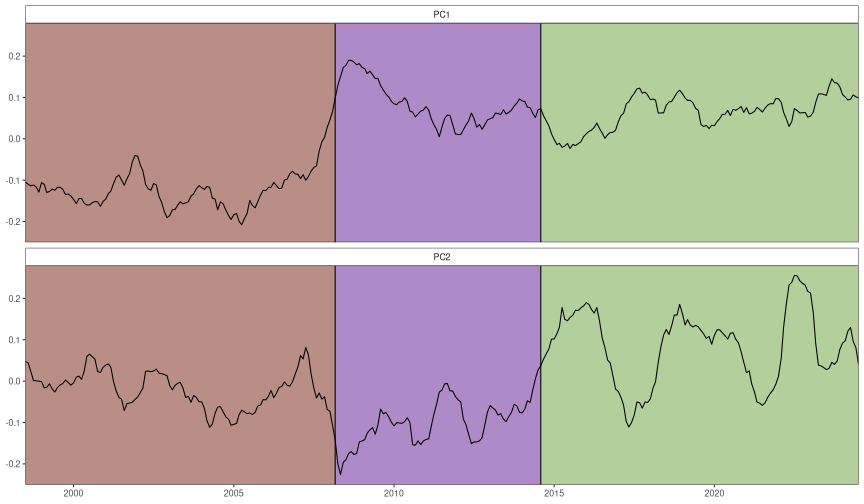
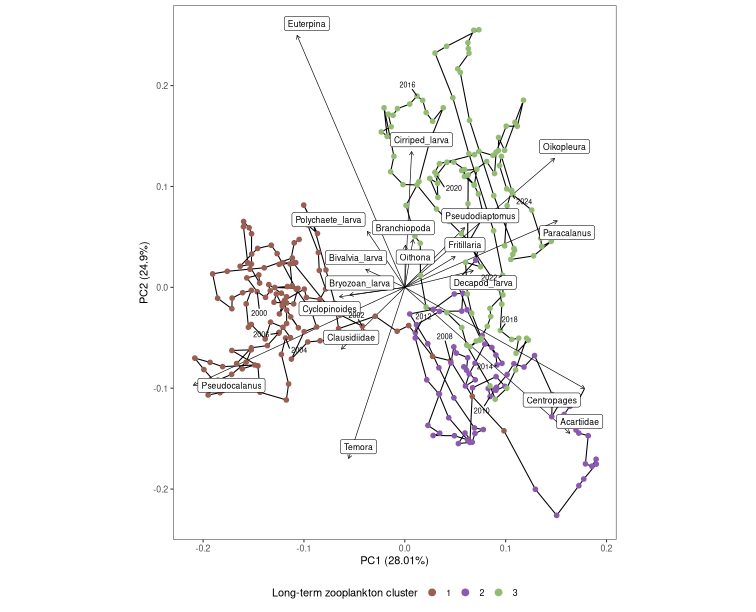

# Display the long-term trajectory of the zooplankton community
Lucien Bastin
2026-10-30

- [Libraries and data](#libraries-and-data)
  - [Libraries](#libraries)
  - [Functions](#functions)
  - [Data](#data)
- [Long-term zooplankton clusters](#long-term-zooplankton-clusters)
- [Long-term zooplankton community
  trajectory](#long-term-zooplankton-community-trajectory)
- [Session info](#session-info)

# Libraries and data

## Libraries

``` r
library(adespatial)
library(conflicted)
library(dplyr)
library(ggplot2)
library(ggrepel)
library(here)
library(lubridate)
library(tidyr)
library(vegan)
```

``` r
conflicted::conflict_scout()
```

    2 conflicts

    • `filter()`: dplyr and stats

    • `lag()`: dplyr and stats

``` r
conflicted::conflicts_prefer(dplyr::filter())
```

## Functions

``` r
source(here("R/extract_pca_data.R"))
source(here("R/palettes.R"))
```

## Data

``` r
zooplankton_deseasonalized <- read.csv(here("Data/Temp/zoo_deseasonalized.csv")) |>
  mutate(date = as.Date(date))
```

``` r
zooplankton_longterm_clusters <- read.csv(here(
  "Data/Temp/zooplankton_longterm_clusters.csv"
)) |>
  mutate(date = as.Date(date), cluster = factor(cluster))
```

# Long-term zooplankton clusters

``` r
zoo_pca <- zooplankton_deseasonalized |>
  select(-date) |>
  rda() |>
  extract_pca_data()
```

``` r
transition_dates <- zooplankton_longterm_clusters |>
  group_by(cluster) |>
  filter(date == max(date)) |>
  ungroup() |>
  filter(row_number() <= n() - 1)
```

``` r
head(transition_dates)
```

| date       | cluster |
|:-----------|:--------|
| 2008-03-01 | 1       |
| 2014-08-01 | 2       |

Make a dataframe to store the positions of the colored boxes to display
on top of the timeseries

``` r
colored_rects_zoo <- data.frame(
  xmin = c(-Inf, transition_dates$date),
  xmax = c(transition_dates$date, Inf),
  cluster = c("1", "2", "3")
)
```

Plot the first two PCA axes and overlay the colored boxes on top to show
the zooplankton clusters

``` r
zoo_pca_series <- zoo_pca$sites_scores |>
  select(PC1, PC2) |>
  mutate(date = zooplankton_deseasonalized$date) |>
  pivot_longer(-date, names_to = "PC", values_to = "val") |>
  ggplot() +
  geom_rect(
    colored_rects_zoo,
    mapping = aes(
      xmin = xmin,
      xmax = xmax,
      ymin = -Inf,
      ymax = Inf,
      fill = cluster
    ),
    alpha = 0.7
  ) +
  geom_line(aes(x = date, y = val)) +
  annotate(
    "segment",
    x = transition_dates$date,
    xend = transition_dates$date,
    y = -Inf,
    yend = Inf
  ) +
  facet_wrap(vars(PC), nrow = 2) +
  scale_x_date(expand = c(0, 0)) +
  scale_fill_manual(values = zooplankton_longterm_clusters_palette) +
  theme_bw() +
  theme(
    axis.title = element_blank(),
    panel.grid.major = element_blank(),
    panel.grid.minor = element_blank(),
    strip.background = element_rect(fill = "white")
  ) +
  guides(fill = "none")
```

``` r
zoo_pca_series
```



# Long-term zooplankton community trajectory

``` r
years_labels <- zoo_pca$sites_scores |>
  mutate(
    date = zooplankton_deseasonalized$date,
    year = ifelse(month(date) == 1 & year(date) %% 2 == 0, year(date), "")
  )
```

``` r
zoo_trajectory_plot <- ggplot() +
  geom_segment(
    data = zoo_pca$species_scores |> filter(sqrt(PC1**2 + PC2**2) > 0.04),
    aes(
      x = 0,
      y = 0,
      xend = PC1,
      yend = PC2
    ),
    arrow = arrow(length = unit(.15, 'cm')),
    lwd = 0.3,
  ) +
  geom_path(data = zoo_pca$sites_scores, aes(x = PC1, y = PC2)) +
  geom_point(
    data = zoo_pca$sites_scores,
    aes(x = PC1, y = PC2, color = zooplankton_longterm_clusters$cluster),
    size = 2
  ) +
  geom_label_repel(
    data = zoo_pca$species_scores |> filter(sqrt(PC1**2 + PC2**2) > 0.04),
    aes(x = PC1, y = PC2, label = species),
    size = 3
  ) +
  geom_text_repel(
    data = years_labels,
    aes(x = PC1, y = PC2, label = year),
    size = 2.5,
    min.segment.length = 0,
    box.padding = 0.5
  ) +
  scale_color_manual(values = zooplankton_longterm_clusters_palette) +
  labs(
    x = paste0("PC1 (", round(zoo_pca$percent_var[1], 2), "%)"),
    y = paste0("PC2 (", round(zoo_pca$percent_var[2], 2), "%)"),
    color = "Long-term zooplankton cluster"
  ) +
  coord_fixed() +
  guides(color = guide_legend(override.aes = list(size = 3))) +
  theme_bw() +
  theme(
    panel.grid.major = element_blank(),
    panel.grid.minor = element_blank(),
    legend.position = "bottom"
  )
```

``` r
zoo_trajectory_plot
```



# Session info

``` r
sessionInfo()
```

    R version 4.6.1 (2026-06-24)
    Platform: x86_64-redhat-linux-gnu
    Running under: Fedora Linux 44 (COSMIC)

    Matrix products: default
    BLAS/LAPACK: FlexiBLAS OPENBLAS-OPENMP;  LAPACK version 3.12.1

    locale:
     [1] LC_CTYPE=en_US.UTF-8       LC_NUMERIC=C              
     [3] LC_TIME=en_US.UTF-8        LC_COLLATE=en_US.UTF-8    
     [5] LC_MONETARY=en_US.UTF-8    LC_MESSAGES=en_US.UTF-8   
     [7] LC_PAPER=en_US.UTF-8       LC_NAME=C                 
     [9] LC_ADDRESS=C               LC_TELEPHONE=C            
    [11] LC_MEASUREMENT=en_US.UTF-8 LC_IDENTIFICATION=C       

    time zone: Europe/Paris
    tzcode source: system (glibc)

    attached base packages:
    [1] stats     graphics  grDevices datasets  utils     methods   base     

    other attached packages:
     [1] hues_0.2.0        tibble_3.3.1      vegan_2.7-6       permute_0.9-10   
     [5] tidyr_1.3.2       lubridate_1.9.5   here_1.0.2        ggrepel_0.9.8    
     [9] ggplot2_4.0.3     dplyr_1.2.1       conflicted_1.2.0  adespatial_0.3-30

    loaded via a namespace (and not attached):
     [1] ade4_1.7-24         tidyselect_1.2.1    farver_2.1.2       
     [4] S7_0.2.2            fastmap_1.2.0       promises_1.5.0     
     [7] XML_3.99-0.25       digest_0.6.39       timechange_0.4.0   
    [10] mime_0.13           lifecycle_1.0.5     sf_1.1-3           
    [13] cluster_2.1.8.2     magrittr_2.0.5      compiler_4.6.1     
    [16] rlang_1.3.0         progress_1.2.3      tools_4.6.1        
    [19] igraph_2.3.4        yaml_2.3.12         knitr_1.52         
    [22] labeling_0.4.3      prettyunits_1.2.0   interp_1.1-6       
    [25] sp_2.2-4            classInt_0.4-11     plyr_1.8.9         
    [28] xml2_1.6.0          RColorBrewer_1.1-3  RNeXML_2.4.11      
    [31] KernSmooth_2.23-26  withr_3.0.3         purrr_1.2.2        
    [34] grid_4.6.1          latticeExtra_0.6-31 colorspace_2.1-4   
    [37] xtable_1.8-8        e1071_1.7-17        scales_1.4.0       
    [40] MASS_7.3-65         cli_3.6.6           rmarkdown_2.32     
    [43] crayon_1.5.3        generics_0.1.4      otel_0.2.0         
    [46] httr_1.4.9          reshape2_1.4.5      spdep_1.4-2        
    [49] cachem_1.1.0        proxy_0.4-29        DBI_1.3.0          
    [52] ape_5.8-1           stringr_1.6.0       splines_4.6.1      
    [55] parallel_4.6.1      s2_1.1.13           adegraphics_1.0-22 
    [58] vctrs_0.7.3         boot_1.3-32         Matrix_1.7-5       
    [61] jsonlite_2.0.0      spData_2.3.5        hms_1.1.4          
    [64] phylobase_0.8.12    seqinr_4.2-44       jpeg_0.1-11        
    [67] units_1.0-1         glue_1.8.1          stringi_1.8.9      
    [70] gtable_0.3.6        later_1.4.8         deldir_2.0-4       
    [73] pillar_1.11.1       htmltools_0.5.9     R6_2.6.1           
    [76] wk_0.9.5            rprojroot_2.1.1     evaluate_1.0.5     
    [79] shiny_1.14.0        lattice_0.22-9      png_0.1-9          
    [82] memoise_2.0.1       renv_1.3.1          httpuv_1.6.17      
    [85] class_7.3-23        adegenet_2.1.11     Rcpp_1.1.2         
    [88] rncl_0.8.10         uuid_1.2-2          nlme_3.1-169       
    [91] mgcv_1.9-4          xfun_0.62           adephylo_1.1-17    
    [94] pkgconfig_2.0.3    

Document rendered using Quarto version 1.10.18.
